# AutoPilot bring-up, Pass 1: flash to operational eligibility

2026-10-21. **Result: a bounded chronological software timeline is established;
physical bootloader handoff, product READY and motion authorization remain
partially unresolved.** This is a factual foundation, not an apfw2 design.

## Integrated timeline update from Pass 2

[Pass2](autopilot-bring-up-pass2.md) extends stages5 and9–12 with continuous
original-code witnesses. The tables below retain Pass1's source trace indices;
the new packet has its own exact indices and oracles.

| Timeline join | Current evidence |
|---|---|
| Retained A after stage7 | Setup without peer input and extended configured execution keep runtime25/requested864300000Hz. Explicit A25 input requests865800000Hz. No cross-channel scan/recovery is demonstrated. |
| Stage9 baseline → stage12 analog polling | True analog-mode reset preserves alpha0.05;128 baseline filter calls make3 acquisitions in the model. Runtime225→900 inputs yield259,291,… and cross X1/X2 bands; the initialization flag does not freeze samples. |
| Stage10 program input → stage11 MC4 → stage12 G | Remote-built mode98 program bytes pass real RX, resync/chain/stage and set marker7b. MC4 releases setup. Nonduplicate G writes its own arm and main-loop phase logic requests `(0,30,500,8119)` at0x6fd8. Two full runs are byte-identical. No AP program/position/validity/arm seed is used. |
| Trigger acceptance versus request | With an accepted program, filtered active input/TR0 causes one reload and leaves arms0. TR1 reports `T900,1,\|` while preventing that acceptance. G can request independently with the trigger HIGH; no-G and duplicate-G controls do not reach request. |
| Additional peripheral progression | TC0 READSYNC at0x40003805 must complete for the selected scheduler path. Existing read-clear instrumentation supplies that disclosed assumption; no counting/IRQ/motor operation is modeled. |

There is now enough evidence for staged, testable application bring-up
predicates. Physical reference, confirmed radio/driver state, a full paired
Remote handshake, USB, STOP/reset while moving and vendor-specific READY remain
distinct gaps. The new request witness stops before commit code executes.

The application initializes outputs and devices before it has loaded its local
configuration. It then waits inside setup for Remote session configuration.
Defaults, retained programs, requested driver settings, a working link and an
armed move are different states. Main-loop entry and a version reply are
demonstrated in simulation; neither establishes physical readiness.

Two consequential qualifications emerge from the assembled sequence. Initial
radio bring-up precedes stored-A loading: a provisioned A25 boot still requests
the A20 frequency before loading25. Also, full reset initializes the analog
filter coefficient to0.05, contradicting the older claim that it is permanently
zero after normal startup. Neither discrepancy should be hidden in future
bring-up specifications.

## Evidence basis and revalidation

“Observed” means original instructions executed in the disclosed model.
“Static” means the cited native/static relationship; “inferred” and “unknown”
retain their ordinary meanings. No new VERIFIED/admitted claims or ledger
grades are asserted. No APTrace implementation, apfw2, original image,
dependency, hardware profile or physical device was changed.

| Source | Use and scope |
|---|---|
| [Pass 1 packet](../../research/generated/bring-up-pass1-2026-10-21/README.md), [commands](../../research/generated/bring-up-pass1-2026-10-21/replay-commands.json), [additional commands](../../research/generated/bring-up-pass1-2026-10-21/targeted-commands.json) |18 direct CLI runs, including11 historical replays and7 targeted controls/observations.54 artifact checks. Source/input hashes and exact outputs retained. |
| [Write-watch diagnosis](write-watch-instrumentation.md) | Memory-hook runs now use instruction boundaries. All selected exposed startup/persistence witnesses below were replayed before reuse. |
| [Vendor flasher](vendor-bossac-behavior.md), [release/bootloader assessment](reversible-firmware-update.md) | Static original PE32/x86 behavior and application-side reset slices; no executed bootloader or physical erase transcript. |
| [Boot/hardware dossier](boot-and-hardware-bringup.md), [resumed readiness](feather-ready-resumed.md) | Reset/core/setup relationships and peripheral dependencies; older use of “main loop” for receive polling is superseded by the distinct milestones here. |
| [Persistence](persistent-state-release-assessment.md), [motor/reference](motor-state-ownership-and-reference.md) | Storage/default/save contract, saved program reconstruction and MC4 versus requested driver state. |
| [TMC interface](../replacement/tmc5160-interface-reconciliation.md), [protocol](protocol-pipeline.md), [auto-mode/plus](auto-mode-and-plus-command.md) | Requested serial transactions, Remote exchange branches and program producers. These slices are not one continuous paired-device startup. |
| [X/trigger](x-trigger-acceptance.md), [A/radio](a-radio-reconfiguration.md), [D identity](d-serial-number-and-compatibility.md) | Selected configuration consumers and separate eligibility states, subject to the new startup qualifications below. |

Revalidation used the documented `tools/unicorn/.venv/bin/python3
tools/unicorn/run_concrete.py` path, Python3.9.6/Unicorn2.1.4. Eleven historical
commands changed only their output destination. **All11 match their prior
full saved registers, dumped memory, stop reason and instruction count.** The
fresh-reader and fresh-startup carry seeds also equal all4097 bytes of the
newly revalidated save, not merely an old file's expected field.

| Revalidated witness | Actual boundary/outcome |
|---|---|
| Packaged868 and915 + MC4 | First `0x93fc` at11,880,918; setup flag0, no watched flash stores; blob remains zero. |
| Configured868 + D1234 + checkpoint | `0x97e6` after program return at17,983,185;1025 four-byte stores, none dropped; provision1 and D1234 retained. |
| Exact saved bytes → fresh reader / full reset + MC4 | Reader restores1234; full startup reaches `0x93fc` at11,864,912 with1234. |
| Provisioned representative motor records → reset + MC4 | First loop at11,864,912; deltas+500/−200 retained; current0, starts0/500, endpoints500/300. |
| Neither PA22 nor ID; ID only; PA22 only | Same bounded waits/failure as before; each stops at its1.2M instruction limit, not successful readiness. |
| Preconfiguration `&` request | Pending reply remains without normal outbound service within3M instructions; instruction-limit stop. |
| MC4 then `&` | Version buffer `V01R39` reaches real TX wrapper at12,095,830;1305 loop entries and684 outbound-dispatch entries. Stops at2000-watch-hit cap, `completed=false`, no native error. |

The exposed witnesses relied on here are revalidated. This does not certify
every historical hooked trace. Historical artifacts and their hashes remain
unchanged. Selected motor/MC4/X helper controls were separately revalidated in
the write-watch audit; static/solver evidence does not depend on that engine
fault. No framework tests were added for this operator investigation.

## Chronological timeline

The order below is the observed/static application control flow. Instruction
indices are from `timeline-default.json`, fake-tick period4000, and **are not
physical elapsed time**. The host/bootloader rows describe requested/static
behavior, not a continuous execution trace spanning those domains.

| Stage / entry | Reads, writes, validation and progression | External dependency / completion or failure |
|---|---|---|
|0. Application update entry, if using vendor workflow | Batch selects product/region/serial port, requests1200baud, waits5s, rediscovers, then invokes `bossac -i -d --port=… -U -i --offset=0x4000 -w -v … -R`. Application request handler `0xb7a8` can arm250-count reset at `0x20000224` when baud1200 and DTR released. Countdown expiry writes magic `0xf01669ef` at `0x2002fffc` and AIRCR `0x05fa0004`. | USB control handler/countdown must function. Original application instructions requesting reset are demonstrated; bootloader consumption, re-enumeration and independent recovery are unknown. Batch success text does not check the flasher's exit status. |
|1. Host erase/write/verify/reset | PE routines `0x004074c0`/`0x004079d0` use explicit raw offset0x4000. Under the identified SAMD51x19 branch:512-byte pages, default write-time erase in16-page blocks.70768 input bytes cover `[0x4000,0x15470)`, page-rounded end0x15600, conditional erase envelope `[0x4000,0x16000)`. Embedded config `[0x12000,0x13001)` is replaced with packaged zeros; there is no merge in these loops. Verify covers input bytes, with capability-dependent checksum/readback. | Depends on actual DID, monitor capabilities, bank/protection and successful I/O. `-U` is USB selection, not unlock; no `-e` does not mean no erase. Successful reset is a host request, not observed application launch. Bootloader/fuse/neighbor preservation is unproven. |
|2. Bootloader → application vector | Original application is mapped at0x4000; reset entry is0xcc24. Application files omit `[0,0x4000)`. | **Missing transition:** no bootloader bytes/trace, vector selection, protection measurement or reset-retention result. Unicorn begins at the application reset entry; it does not establish this handoff. |
|3. Reset/core/platform initialization | `0xcc24` copies initialized data into RAM, zeroes BSS, enables FPU through CPACR/DSB/ISB. `0xcdd8` configures clocks/analog blocks and reads calibration around0x00800080/84. `0xcd90` follows Arduino init/constructors/variant/delay/USB/setup, then repeats loop/yield/serial service. | Model maps zero calibration placeholders, supplies tick and completion bits. These do not establish valid trim, oscillator startup, interrupts or USB enumeration. Poll conditions detailed below. |
|4. Setup/input and early output initialization | Setup `0x9464` at29,324 configures the radio object and calls `0x6968` at29,345. PA02 chooses runtime mode at0x20001fc0 (HIGH1 analog, LOW2 digital). PA22 must remain HIGH across the tested elapsed interval>1799 nominal millisecond ticks. Exit0x69d8 at7,236,030 proceeds through GPIO/timer/bus initialization. | PA22 low resets/repeats the wait; ID alone does not bypass it. Tested waveform is HIGH then LOW at0x69d8. This is not demonstrated homing or physical reference establishment. Outputs are already being configured; do not assume this stage is electrically inert. |
|5. Initial radio bring-up | `0x610c` at7,243,146, probe `0x9d88`, then frequency setter `0x9b20` at7,322,322. Reads runtime A20 and base864000000; requests864300000Hz. Probe reads register0x42 and requires0x12. Requests optional reset pulse, LoRa mode/frequency/modem settings; clears transport selector0x20000018 on success. | Expected ID is CPU-forced in startup replay. Failure enters `0x612e`'s LORA ERROR display/delay loop; it is not a demonstrated retry of the probe, rollback or safe motor stop. Full RF transport/readback is absent. Crucially, persistent A has **not yet been loaded**. |
|6. Motor/session initialization before local config | `0x6190` at7,335,661 runs before boot config reader. Existing evidence places four driver objects and SERCOM5 initialization here/in the surrounding startup chain; session parameter consumers use compiled runtime values. | Requested initialization is not confirmed driver configuration. MC4 has not arrived. Detailed late-update dependencies beyond the known current/microstep paths remain partial. |
|7. Lazy local storage load and field validation | Reader `0x4c20` at7,344,678 invokes0x9768→0x9724→0x990e as needed. Reads4097 bytes from0x12000. Provision byte0 makes staged4096-byte payload FF; loaded becomes1. A outside20..25 defaults20 and stages20/dirty1. X outside1..2 defaults runtime1 **without repairing its stored byte**. D requires markerDE at+0x19, else runtime0. Program marker+400 and records are then loaded. | Provision check is zero versus nonzero, not a CRC/schema/integrity test. Caller geometry/source must be initialized. No external peer required for local load. Defaults are not a complete coherent “factory configuration” committed at this point. |
|8. Program sanitization/re-reference/staging | Loader `0x4b64` at7,393,972 copies1152 bytes from payload500..1651 to0x20001b40 and loads flags300/301. It normalizes selected record-count bytes>4, writes selected initialization fields, conditionally consumes per-channel resync requests0x20000134. Resync0x4b24 anchors onto software current; chain0x4ca8 computes endpoints. `0x43f0` stages changed records; four calls occur in the default/retained fixtures. | No new plus transfer is required to load a local copy. Synthetic saved records prove deltas can survive while saved coordinates are replaced. Software current0 is not physical zero; truthy validity bytes are not integrity proof. No physical reference-valid gate is established. |
|9. Version/input baseline and boot driver requests | Version writer0x4328 at7,499,323 builds `V01R39\0` at0x20003134. `0x5d44` at7,499,340 performs delays/control resets and, when input mode is not2,128 filter calls for a baseline. `0x7770` at9,496,107 applies temporary current input400 and microstep16 to all four driver objects through0x7514→0xae60/0xb070, then restores desired current RAM. It makes GPIO/pulse and status-read requests and builds MT status. | Startup requests include two48-pass pulse sequences across four channels; no motion command/commit is needed for these outputs. MT digits depend on modeled device reads; `MT11112\|` does not prove four devices or READY. Last digit is input mode/result, not READY. Current400 is a helper input, not established mA. |
|10. Setup polling / Remote synchronization opportunity | At0x94b8 (11,331,843), setup enters its own loop while0x20000060≠0. It polls0x8960 and PA22 housekeeping0x5dd0, and periodically transmits MT after>700 millisecond ticks. Remote's0xc440 exchange sends S and validates responses; successful tail can send bulk plus98 under its separate program-data flag, then MC4. | Receive polling/parser entry alone is insufficient: preconfig `&` sets pending[5] but does not drain through normal outbound dispatcher. Actual peer handshake, RF delivery and reconciliation are not demonstrated by injected bytes. Stored programs alone do not guarantee a Remote resend. |
|11. MC4 session configuration / setup exit | Injected real-format56-byte MC4 passes original RX/dispatcher0x8258 at11,654,958. Four0x7a98 calls set arrays: first20×80→1600, second2400, third1→0, fourth25, each for four channels. Dispatcher clears0x20000060 at0x8718 (11,877,998). Setup returns0x94e4 at11,880,916; first real loop0x93fc at11,880,918. | Requires appropriate packet/timeout behavior; selected values are sufficient examples, not safe/minimum physical settings. MC0–3 do not cross this MC4 gate. MC4 does not itself demonstrate program transfer or persistent save. Setter requests after MC depend on elapsed>300-tick configuration timestamp; setup exit does not acknowledge driver application. |
|12. Operational scheduler / response / eligibility |0x93fc calls0x7b8c,0x7e2c,0x5fac, then time-conditioned channel handling or0x8e18→0x9268→0x8960→housekeeping/monitor. A post-config `&` yields `V01R39` at real TX0x8c10, with continuing loop entries. G selection/request state and pre-trigger phase-arm state are separate. | Scheduler branches mean every service is not executed every iteration. Version reply proves bounded configured command service in the model; no USB host path or RF delivery. Trigger/motion conditions below remain independent. |
|13. Later checkpoint, recurring or conditional | PA22 housekeeping and channel0-completion0x449c can reach0x97a4. If dirty, set provision1, copy payload, erase0x98f0 then program0x984c. Geometry constructor0x981c reads PARAM;0x60400 yields512-byte pages and8192-byte erase stride. | There is no universal “save defaults when READY” checkpoint established. A later input/event matters. Flat memory does not implement erase physics, brownout, flash integrity or retention. Save does not clear dirty in the examined routine, so repeat writes remain possible. |

### Peripheral progression conditions

| Register/model input | Requested/observed condition and bound |
|---|---|
|0x4000140c, OSC32KCTRL.STATUS | Bit0 readiness supplied; existing static preceding XOSC32K write0x200e. External clock adequacy is not proven. |
|0x40001010, OSCCTRL.STATUS | DFLLRDY bit8 supplied; preceding DFLLCTRLB0x98. |
|0x40001040 /0x40001054 | Both DPLL LOCK/CLKRDY bits0/1 supplied; existing preceding CTRLB0x800 and enable request. |
| SERCOM5 0x43000400/18; SERCOM2 0x41012000/18 | Clear SWRST bit0 and supply DRE bit2; RAM/MMIO records are not simulated external devices. Driver configuration requests include SERCOM5 SPI master DOPO0/DIPO3, transaction mode3/2MHz request. |
| Radio settings requests after ID success |0x9b20 encodes `floor(Hz×2^19/32000000)` into registers06/07/08; A20 requests bytesD8/13/33. Other calls request SF7 (0x9bb0), bandwidth250000Hz (0x9c14), coding parameter5 (0x9cac), power parameter17/output1 (0x9d2a), CRC enable (0x9cdc), FIFO bases0 and operation-mode requests80/81. Nominal LoRa/register interpretations are qualified in the A dossier; these are requests, not a measured final register set or complete packet-default contract. |
| PORT.GROUP0.IN0x41008020 | Bit22 models PA22; bit2 selects PA02 input mode. Default timeline uses PA02 low/digital2. No electrical input reliability claim. |
| NVMCTRL.PARAM0x41004008 /INTFLAG0x41004010 | Save fixture supplies0x60400 and DONE bit0. Missing geometry can give zero erase stride; missing completion can stall. Neither is a radio transport failure. Released/no-save paths do not establish requirements for later saves. |
| Runtime tick0x200052ec and delay0xcd34 | Instruction-paced tick, DWT delay stub; not actual SysTick/IRQ/jitter measurements. Packet assembly uses a cumulative timeout and needs the recorded timing assumption. |

SERCOM2 radio TX requests use PA15 CS and DATA0x41012028. Motor serial requests
use SERCOM5 DATA0x43000428 with logical CS PB08/PA18/PB09/PA19. STEP/DIR outputs
are distinct from that serial bus. On an intact Feather, PB10/PB11, PA08/PA09,
PA10/PA11 overlap its onboard QSPI. No physical execution recommendation follows;
the conflicts remain unresolved and startup itself requests outputs/pulses.

## Three scenario timelines and durability/recovery

| Scenario | Established sequence/result | Important boundary |
|---|---|---|
| Fresh vendor installation | Conditional host write replaces embedded configuration with zeros. On application boot provision0 causes FF staging; A becomes20/dirty1, X runtime1, D0, session markerFF. Loader normalizes/references/stages selected motor fields. After external MC4 both variants reach first loop with flash still all zero. | Static flashing consequence joined to observed application startup; not one measured flash→boot run. No complete valid program or physical position follows from defaults. |
| First later default checkpoint | New `defaults-checkpoint` removes D injection from the known save scenario and holds PA22 HIGH at setup return. Save enters at17,906,055; erase17,922,468; program17,922,488; stop0x97e6 at17,943,185.1025 stores, provision1, A20, X storedFF, D marker/value FF, dirty still1. | Demonstrates one original-code checkpoint that commits reconstructed state, **not automatic commit at first loop**. Input timing/geometry/DONE are disclosed. Next boot still defaults X and D; a nonzero provision byte does not mean every field is valid. |
| Normal subsequent boot with selected retained state | Exact newly saved D1234 bytes loaded in a fresh machine restore1234; original startup+MC4 reaches loop. Provisioned motor fixture restores deltas but rebases starts/endpoints onto software current0. Session MC4 still has to be supplied in these fresh resets. | Persistence is logical byte carry, not real power-cycle proof. MC4 arrays/phase arms/filter state are volatile and are not demonstrated as saved by MC4. Program-copy agreement with Remote remains unproved. |
| Retained non-default A25 | New full reset uses provision1/A25 in simulated data flash. Radio initially requests864300000Hz from compiled A20; reader later changes runtime A to25. No second bring-up before first loop. | Observed requested frequency/runtime mismatch in this startup path. Do not assume “retained A is applied before communication.” Actual reconnect repair or other caller behavior needs Pass2; RX injection cannot prove the mismatched pair communicates. |
| Missing/invalid selected fields | Packaged-zero full boot is already the fallback witness. Three new direct-reader controls use allFF, zero payload/provision1 and zero payload/provision2. All return A20/X1/D0. MarkersFF/1/2 are retained; A is repaired in staging, X remains invalid in storage. | Direct helpers do not demonstrate full startup or motion safety for arbitrary corrupt blobs. Zero-only provisioning validation accepts noncanonical nonzero markers. Marker400 and individual record checks remain independent. |
| Interrupted update/save | Host image writes can destroy application/config or neighboring erase-block content before verify/reset. Application save sets staged provision1 before erase/program and has no demonstrated transactional integrity guard in this chain. | No physical interruption or faithful erase/power-loss model was exercised. Partial-image executability, partially programmed blob handling, rollback, atomicity, retention and independent recovery remain unknown. Do not infer reliable recovery from the selected invalid-reader cases. |

This integrates package6's default/staging/checkpoint/reset questions without
decoding every field. Intentional restoration to packaged settings is supported
at the application-model tier; complete device restoration is not. No new
A/X-specific paired durable round trip, every-byte corruption matrix or
universal checkpoint schedule is claimed.

## Read/write and lifetime map

| State/address | Initialize/read/modify | Durable? / significance |
|---|---|---|
| Blob0x12000..0x13000 inclusive | Packaged zeros; original loader reads4097 bytes; save makes1025 four-byte stores (4100 bytes, including rounding). | Application-local flash. Whole erase block `[0x12000,0x14000)` must not be assumed otherwise free or preserved. |
| Staging base0x20003145 | Loaded at+0; payload at+1; provision at+0x1001 (0x20004146); dirty+0x1002 (0x20004147). Setter0x977c dirties on changed bytes. Constructor/reset0x97f4 clears loaded/dirty. | RAM only. Save does not itself clear dirty; driver reset is a separate operation. |
| A payload+0x1a /RAM0x20000069 | Compiled20 used by early radio; boot reader validates20..25; A command stages then reinitializes. Base RAM0x20000000 is864000000 or915000000. | Stored value and requested/applied/peer channel can differ. Normal UI channels1..6 map base+300000×(A−19). |
| X payload+0x33 /RAM0x20000194 | Boot fallback1; X1/X2 stages byte; analog polls write bands[200,580]/[250,750]. Mode0x20001fc0 selected separately from PA02. | Selector persistent only after checkpoint; mode/threshold/filter/sample state volatile. Invalid boot X fallback is not stored repair. |
| D payload+0x15..18, marker+0x19 /RAM0x200029d4 | Big-endian u32 accepted only withDE; otherwise0. D command mutates staging. Bulk-report field9 feeds Remote SN display. | Retention demonstrated1234. No demonstrated motion/trigger/calibration dependency in the bounded D work. |
| Program marker+400 /RAM0x20001b38 | Boot load; accepted bulk-plus finalization writes7b. | Persistent marker is separate from record validity and transfer/reference agreement. DefaultsFF fail the examined trigger marker gate. |
| Flags+300/301; records+500..1651 /RAM0x20001b40 | Four0x120-byte channels. Delta+0, start+0x10, endpoint+0x0c; record stride0x48, validity+0x44. Reload/resync/chain/writeback can change derived state. | Local persistent execution copy. Remote authors deltas; software target/reference can be reconstructed, physical position cannot be inferred. |
| Current0x20002064[4], resync0x20000134[4] | Current initializes to0 in tested reset; conditional resync uses current and clears requests. | Volatile software coordinates/requests. No verified physical-reference-valid bit is established. |
| MC arrays0x2000006c/dc/f0/0x20000138 | Remote MC4 writes1600/2400/0/25 in example; third1 remaps0. Driver-update timestamp can suppress later setters. | Session state; no MC4 persistence demonstrated. Desired versus last-requested versus confirmed hardware values differ. |
| Setup0x20000060; pending0x200025bc[] | Compiled setup gate1, MC4 clears0. `&` sets pending[5]; normal outbound dispatcher consumes it only after setup returns in the tested path. | Volatile. Setup exit is neither program validity nor an RF/USB connection flag. |
| Filter alpha0x20000014; flag0x20003118; float0x2000311c; deadline0x20003124 | Full-reset snapshots show `cd cc 4c 3d` (0.05) already at setup. First due acquisition initializes; later due calls blend. Clock deadline uses nominal microseconds; reporting uses milliseconds. | Volatile initialized data/filter state, not X persistence. See correction below. |
| Trigger report0x20003120; idle0x200000d8; channels0x20002524; phase arms0x20002318 | TR can report while blocking reload; idle9/all channels0/marker7b required for normal reload. Valid record processing clears phase arm and idle. | Recognized, reported, accepted reload and armed move are separate states. |
| G targets0x2000201c; phase/arm0x200025e0/e1 | G selects start/endpoint under mode/validity; subsequent request passes target−current to0x6fd8. | Volatile request state; not equivalent to trigger phase arms. Commit entry is only a software request boundary. |
| Factory/identity0x00800080/84 and0x008061fc/0x00806010/14/18 | Clock/analog trim and USB-identity formatting reads identified separately from blob. | No actual unit values/readiness verified. These are not reconstructed by default config or the vendor application image. |

### Correction: analog initialization versus the zero-alpha fixture

At setup entry, every new timeline observation already contains alpha0.05,
and it remains0.05 through first loop. The default timeline chooses digital
mode2, so it does not establish analog electrical behavior or an end-to-end
analog trigger chain. However, it directly contradicts the older `.bss`/
permanently-zero claim: this address is below the documented BSS start0x20000830.

A single targeted helper experiment reuses the existing due-sample fixture,
changing only alpha to the full-reset bytes. With old225/new900, original
0x42a4 computes258.75 and returns259. Thus a set initialized flag does not
itself freeze samples. Prior zero-alpha fixtures still demonstrate their
conditional software behavior; they do not establish that normal startup
produces zero alpha or that a physical misfire was caused by that condition.
The cause of every older boot-chain fixture's lost initialization is not traced
in Pass1. Pass2 now demonstrates continuous analog-mode reset, acquisition,
filtering and native program/trigger guards; no physical reliability conclusion
is substituted.

## Readiness and motion state transitions

```mermaid
flowchart TD
  H[Host requests flash / verify / reset] -. unobserved physical handoff .-> R[Application reset]
  R --> I[Core and early output initialization]
  I --> P[PA22 wait]
  P --> Q[Initial radio probe and settings request]
  Q -->|ID failure| E[LORA ERROR loop]
  Q -->|modeled ID success| C[Load and normalize local config / program]
  C --> B[Baseline and boot driver / pulse requests]
  B --> W[Setup receive / MT / housekeeping loop]
  W -->|bulk plus98 input| PG[Accept program / resync / stage]
  PG --> W
  W -->|MC4 accepted| L[Application loop and outbound service]
  W -->|conditional PA22 event| S[Checkpoint if dirty]
  L -->|conditional checkpoint event| S
  L --> G[Independent request / trigger eligibility states]
  G -->|valid selection and armed request path| M[Motion request boundary]
```

This diagram omits repeated internal device transactions and does not assert
that all loops or failures are drawn. In particular:

- **Application execution:** reset/setup reached. **Peripheral progress:**
  polls/probe passed under assumptions. Neither proves real device readiness.
- **Communications available:** configured original code services a version
  request through the radio-selected wrapper. Peer reception, RF lock/defaults,
  paired synchronization and USB endpoint responsiveness are unproven.
- **Driver configured:** initialization and later setter requests observed;
  valid register readback/active electrical state is not demonstrated.
- **Program/reference valid:** marker7b, truthy per-record byte, software
  current and resync are different checks. None supplies physical homing truth.
- **Trigger accepted:** active analog/digital classification plus TR0,
  marker7b, idle9 and four idle channels reaches reload0x8f98→0x6e4c.
  Reload can prepare valid records but clears the examined arms. An already
  armed valid record can reach commit earlier in0x8e18, before trigger polling.
- **Motion authorized:** Pass2 closes a selected continuous AutoPilot
  reset/program/MC4/nonduplicate-G→request chain, using captured Remote frame
  bytes and disclosed peripheral/input assumptions. The full Remote session,
  STOP/reset while moving, physical activation and a unified safe permission
  policy remain unproven. Startup pulses also occur outside that boundary.

No separately grounded vendor READY predicate was found. The strongest
revalidated operational milestone is configured loop execution plus original
read-only command service. No single READY bit can replace the distinctions
above. In particular, no new USB or physical READY claim is made.

## Execution boundaries, gaps and Pass 2

APTrace selected existing documentary/static evidence and direct bounded
concrete replays; no new firmware analyzer, harness or independent execution
engine was introduced. All18 native commands exited0. Instruction-limit and
watch-cap runs retain `completed=false`; exit0 is not treated as success at a
readiness goal. No native initialization failure occurred on these direct
invocations; the separate macOS execution-context restriction remains relevant
to other invocation forms. No toolchain rebuild or security bypass was used.

| Priority / next bounded investigation | What current APTrace can establish | Missing evidence/capability |
|---|---|---|
|1. Retained-channel application and reconnect | Follow only the first post-startup radio-init callers and a selected successful Remote exchange with A25 on both sides; distinguish stored, runtime and requested frequencies. | Injected RX cannot show a physical pair finds each other. Faithful RF/peer delivery or a known-good trace needed for link claims. |
|2. Analog initialization continuity | One true analog-mode reset, preserve initialized RAM, deliver two due sample boundaries and observe effective samples/eligibility. This tests the newly contradicted permanent-freeze assumption without another broad trigger census. | ADC electrical accuracy/pulse reliability still require hardware evidence. Older zeroed helper fixtures are not a cold-boot oracle. |
|3. Natural motion eligibility/STOP/reset join | One programmed channel through real session exchange, program acceptance, arm producer, trigger/request boundary and STOP/reset controls; observe requested driver settings alongside it. | Asynchronous interrupts, physical position/reference and motor activation are not established by stitched helper runs. No physical motor work proposed here. |
|4. Selected durability/recovery cut points | Existing exact-byte carry can test a specific mixed/partial blob and repeated dirty checkpoint, including A/X repair differences. | Unicorn flat writable flash and forced DONE do not establish erase/program atomicity, ECC, retention, brownout or recovery. A hardware-faithful NVM/reset model would require separate development; physical validation requires separate authorization. High-priority gap before durability certification. |
| Separate release prerequisites | Reuse static vendor/boot/reset findings to bound an acquisition/validation plan. | Actual bootloader bytes/capabilities, protection/bank state, independent recovery, correct unit/region and erase footprint are missing physical evidence. Additional application traces cannot close those gaps. |

Pass1 stops with the selected affected witnesses revalidated, sequence and
lifetimes integrated, and consequential contradictions exposed. Package6's
software defaults/checkpoint/reset basis is now part of this timeline; it is
not a completed physical durability qualification. No requirement to copy a
particular Noxon quirk into apfw2 is inferred. Release gates A/B/C/D remain
PARTIAL, E/F BLOCKED; production NO-GO and the intact-Feather prohibition remain.
