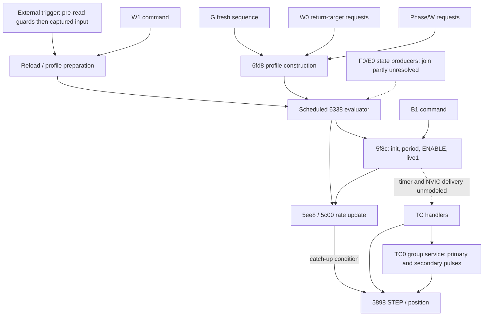

# Target3 — motion-initiation sinks, producers and coverage

2026-10-22. **The known motion graph is larger than the descriptive trigger
model.** This investigation confirms an original `B1` command timer start before
MC4/setup completion and without a valid program marker; continues G through
actual timer enable; confirms W1-driven playback without an external trigger;
and demonstrates direct STEP writes from period catch-up and a multi-channel
TC0 service fragment. These routes are not automatically defects: their intended
authorization differs from external trigger acceptance.

**Coverage remains partial.** No complete sink/route theorem or timer-to-NVIC-to-
physical-motor execution is established. Both formal model packages are preserved;
recommended corrections and proof boundaries are documented below.

[Evidence packet](../../research/generated/motion-route-target3-2026-10-22/README.md),
[sink inventory](../../research/generated/motion-route-target3-2026-10-22/sink-inventory.json),
[route matrix](../../research/generated/motion-route-target3-2026-10-22/routes.json),
[native outcomes](../../research/generated/motion-route-target3-2026-10-22/outcomes.json),
[coverage extraction](../../research/generated/motion-route-target3-2026-10-22/graph-coverage.json).
No original firmware, apfw2, hardware, analysis implementation, ledger admission
or release grade was changed. Simulation only; no physical motor operation.

## Scope and evidence discipline

Start from [Target1](startup-voltage-learning.md), [Target2](trigger-symbolic-reachability-target2.md),
[descriptive Noxon verification](noxon-trigger-state-machine.md),
[motor ownership/reference](motor-state-ownership-and-reference.md),
[bring-up Pass1](autopilot-bring-up-pass1.md)/[Pass2](autopilot-bring-up-pass2.md),
[request campaign](trigger-misfire-failure-modes.md),
[Remote-to-motor trace](remote-to-motor-causal-trace.md),
[pin map](../hardware/firmware-pin-function-map.md), and
[TMC reconstruction](../replacement/tmc5160-datasheet-reconciliation.md).

Image: original AutoPilot868, SHA256
`6dcdb4c1cbe5cae08704d5ff5d9db33173bc2c69c563b4b694fe0c28492c52e3`.
No new915 route execution/equivalence claim. Public Ghidra interfaces, fresh
independent `macaw-census-expand`, targeted public `explore`/`function-effects`,
and documented direct Unicorn CLI were used. No replacement decoder, SMT model,
interrupt scheduler or analysis framework was created.

Distinguish these observations:

1. A command/record prepares a profile or motion request.
2. A peripheral is configured, a rate/CC value updated, or a driver/control
   setting requested.
3. Timer ENABLE is written, allowing periodic generation **if** clock/IRQ
   conditions hold.
4. Original software writes STEP HIGH/LOW or an auxiliary GPIO toggle.
5. Actual electrical pulse timing and motor movement — **not established here**.

Old “no writer sets live1”/“no0x6fd8 means no motion” statements in historical
reports are superseded by the request campaign and present results. Function
names and cached function ownership are not motion semantics or completeness
proofs. In particular, the historical `tc0_isr_completion` label spans multiple
chunks, and `digitalWrite_pulse__STANDARD_LIBRARY` is application-specific pulse/
position logic despite its provenance label.

## Sink inventory

| Sink/category | Original operation | What it establishes / limits |
|---|---|---|
| Timer enable0x5810 | Channels0..3 select TC0 `0x40003800`, TC1 `0x40003c00`, TC2 `0x4101a000`, TC3 `0x4101c000`; clear16-bit COUNT+0x14 then OR CTRLA with2. Selector7 clears TCC1 COUNT+0x34 at `0x41018000` and also ORs2. | Six isolated original calls confirm0..3/7 enable the selected peripheral; unsupported4 does not. No program/reference/driver validation here. No automatic IRQ/pulse follows from plain-MMIO ENABLE. |
| Rate start0x5f8c | Calls0x5570 initialization,0x5ee8 rate/period,0x5810 enable; writes live1 at0x5fa4 into `0x20001b14[ch]`. | Common start sequence. Callers include evaluator0x6338 **and B1 tail0x84e2**. It does not itself require profile eligibility or the Target2 trigger gate. |
| STEP emitter0x5898 | Adds signed per-channel delta `0x20000094[]` to software position `0x20002064[]`; divisor `0x20003099[]` gates HIGH/LOW requests through0xd388 using pin table `0x20000164[]`. May stop at target afterward. | Actual output-request sink. It can be called from an IRQ, callback, group service or period-update catch-up. It does not first require timer ENABLE/live1 or trigger acceptance. This is not a claim all arbitrary inputs produce a pulse. |
| Period update0x5c00 | Writes CC0, requests READSYNC, compares synchronized COUNT against scaled new period; excess-count branch calls pulse service and clears COUNT. | **Can emit a STEP request without a new ENABLE write.** It is not always mere preparation. Controlled default-scale COUNT200/period100 emits; equal100/below99 do not. |
| TC handlers |0x607c→0x5be8 for TC0;0x6098/0x60b4/0x60d0 call0x5898 for channels1/2/3 after flag writes. | Direct handler-body executions emit the selected PB10/PA08/PB12/PA10 write pair and advance only that software position. Not autonomous interrupt delivery, pending-state validation or physical waveform proof. |
| TC0 group branch |0x5be8 reads selector `0x20003098`: zero→0x5898(0), nonzero→0x5994. Group service calls0x593c (primary channel selected via `0x20003130`) and may call0x5898 for secondary selected channels. | One master service can pulse multiple motors without each slave TC being enabled. Seeded fragment demonstrates channels0+1; natural group arming/complete lifecycle remains unresolved. |
| Auxiliary TCC1 |0x5d24 sets period6000 and directly enables TCC1, independently of0x5810. Handler0x60ec acknowledges a TCC flag and writes PB22 OUTTGL `0x4100809c`, mask0x400000. | A separate enabled pulse/toggle facility. Startup enables/disables are already observed; new isolated handler toggles PB22. Its physical purpose is unassigned, not established as a fifth motor. |
| Driver/control configuration |0x77a0 raises PB16/PB17 after delay;0x77f8/0x7868 set PB06/PB07 differently then lower PB16/PB17. Startup0x6968 has its own HIGH sequence. TMC serial writes request current, microsteps, GCONF/CHOPCONF settings. | Enables/configures control or power behavior, **not proof of STEP generation**. Physical identity of those GPIO controls remains unresolved; do not equate them with an MCU-controlled DRV_ENN. |

The low-level GPIO helper0xd388 has55 recovered call sites. The known STEP
emitter's pin table is resolved, but those55 generic calls were not all proved
incapable of selecting STEP pins through dynamic data. Pin mux/direction changes,
external STEP inputs, and driver-internal generation cannot be excluded by this
MCU timer inventory alone.

## Producer and dependency map

This mixes explicit call edges and labeled scheduler/state/peripheral edges.
It is not a claim they are all direct calls or all continuously validated routes.

| Producer/route | Conditions recovered | Strongest evidence / exit boundary |
|---|---|---|
| External digital trigger | Four channel bytes0, marker32=0x7b, idle **byte**9, TR0 checked **before digitalRead**; captured R0=0 selects0x8f98 afterward. Setup/mode are upstream context. | Target2's feasible SAT and exclusions support these local digital components; existing continuous original reset/program/trigger→profile→enable witnesses support the join. State stability across read remains an assumption. |
| External analog trigger | Same software guards in analog suffix; filtered value outside inclusive X1[200,580]/X2[250,750]. Raw input need not remain active. | Native/static plus continuous filter-history witnesses; no arbitrary-history SMT theorem. |
| W1 | Native0x85ee..0x8624 requires all four channel bytes0 and marker7b, then calls shared reload. It does not test a fresh external event, TR0 or idle9 in that command suffix. Valid records/profile scheduling remain downstream conditions. | **New continuous reset/program/MC4/W1→enable**, with trigger HIGH and no G or trigger acceptance. A nonzero-profile replay and the earlier zero-timing fixture are separate artifacts. |
| G | Shared sequence freshness arms G state;0x7e2c selects target, then0x6fd8 builds request/profile using target−current. TC READSYNC completion modeled. | **New continuous G→0x6fd8→0x6338→enable**, trigger HIGH. Old no-G/duplicate-G controls exclude the G request in their scopes, not every other possible initiation. |
| W0 | Tail0x85e6→0x72ac iterates all four channels. Mode word==20 chooses alternate target array; otherwise record start+0x10. Subtracts software position, selects rate table, calls0x6fd8 at0x72de/0x7312. | Native static route. No complete natural nonzero W0→enable witness added. Cache's missing caller/function names do not eliminate this actual tail path. |
| Bare W / phase requests | Record validity/phase arms and idle conditions, stop/live wait and target/current relationships lead to0x8fee/0x9050 calls to0x6fd8. | Static and earlier bounded phase controls. W-after-trigger can wait for live to clear while an earlier profile has already started. No completed natural phase re-arm route proved. |
| F0/E0 jog family | Existing RX→0x5448/0x4d18 writes channel state2/profile mode2, target/rate and direction state; conditional control re-enable. Evaluator's mode2 path can call0x5f8c. | Existing continuous **RX→state only**, plus static evaluator path. A natural complete jog→enable→stop session is not proved; no fresh trigger gate is assumed for intentional jog. |
| B1 | `0x2000312d==0` and channel0 live byte0 before work; sets latch, calculates rate from scalar `0x2000012c`, rechecks live0, tail-calls0x5f8c(0). | **New continuous original reset/B1→enable before MC4**, markerff. Latch1 and live1 injection controls block start through14M. No natural “healthy driver”/physical-reference check is established. |
| Rate update/catch-up | Supported channel, scale/prescaler state, READSYNC completion and count/period comparison. In tested scale1 case, COUNT>period calls pulse service. | **New local native pulse and negative controls**, including timer CTRLA still0. Not a demonstrated unauthorized normal-session step or a physical counter model. |
| Independent TC pulse service | Timer/IRQ delivery and pin/delta/divisor state supply context.0x5898 does not recheck the trigger gate or live1 at entry. | New isolated handler bodies0..3 emit actual output requests. They do not show a stale/pending IRQ is naturally delivered after STOP. |
| Group TC0 service | Nonzero selector0x20003098; primary callback; group count, nonzero ratio, direction and threshold comparisons select secondary pulses. | **New seeded original fragment**, primary0/secondary1. Ratio0 and raised-threshold controls suppress secondary; no natural program→group arming proof. Selector writers recovered in program/config/T-command/monitor paths remain integration leads. |
| Auxiliary startup/internal activity |0x5d24 calls occur in baseline and recovered housekeeping/radio-related paths.0x434c disables TCC1 and lowers PB22. | Existing startup enable/disable witness plus current callers and isolated auxiliary handler. Old “only baseline calls it” wording is not a completeness claim; other caller feasibility remains bounded/static. |

No row establishes real RF delivery, physical reference, actual driver readback,
healthy mechanical state or physical motion. Absence of the trigger gate on a
manual/internal command is not automatically an authorization defect.

## Consequential new native witnesses

### B1 is independent of setup/program readiness

The original reset path receives only `B1|` through the native RX ring at0x94b8.
No AP program, arm, profile, reference or live flag is seeded in the positive
run; no plus program or MC4 is sent. ADC225 remains inactive. In the original
instruction stream:

- 0x5f8c at11,357,471, channel0, caller LR0x8a39 rather than the evaluator;
- 0x5810 at11,357,605;
-live write0x5fa4 at11,357,617; stop0x5fa6 at11,357,618.

Endpoint marker=`ff000000`, setup flag1, B1 latch1, live[0]=1,
TC0 CTRLA=`0x602`, CC0=`0x3d09`. The rate scalar is20 after normal reset.
This proves software initiation before the normal MC4 wait finishes. It does
not prove B1 is an accidental command, a particular Remote UI feature, a valid
physical trajectory, or safe operation. Both guard controls are explicit RAM
injections at the RX boundary, not natural independent sessions.
The same native family gives B0 different behavior: it requires channel0 live
nonzero and its own latch clear, then updates rate/state rather than directly
entering0x5f8c. B2 takes stop/control helpers. Neither is silently counted as
another B1 start.

### G converges on profile playback; W1 is another producer

Continuing the prior G/HIGH witness beyond0x6fd8 gives:
request12,138,041 → rate start12,154,460 (LR0x692f, scheduler) → live12,154,615;
stop12,154,616. Endpoint profile mode1, channel state1, live1, TC0 ENABLE set.
Thus G's “direct request” is a producer boundary, **not necessarily a distinct
hardware backend**: this run constructs a profile and uses the common evaluator.

W1 likewise reaches reload and evaluator-driven timer enable with no accepted
external trigger and no0x6fd8 call. The nonzero program frame is the previously
recovered original Remote builder's `+2,1,1,0,98,1,0,50,1000,500,0,0|`.
The separate older zero-timing frame also starts (period clamped20), but is not
used as evidence of a qualified trajectory. Both executions are retained with
their exact packets; neither establishes paired Remote UI/RF/ACK continuity.

### Period maintenance and a master handler can directly emit pulses

The isolated original0x5c00(0,100) call, with COUNT200 and current scale state0,
executes0x5c64→0x5be8→0x5898. Original GPIO writes at0xd3d0/0xd3cc request PB10
HIGH/LOW, mask0x400; software position becomes1; COUNT becomes0. CTRLA remains0.
COUNT100 and99 controls update the period without pulse/position increment.
Pin/delta/divisor and READSYNC completion are disclosed prerequisites. This can
be intentional compensation when changing a running period; the seeded disabled-
timer state is not asserted to occur naturally.

The isolated group0x5994 fragment, with primary0, one secondary selector1,
ratio1, direction1 and threshold0, calls0x5898(0) and0x5898(1), advancing both
software positions and writing both STEP pairs. TC1 remains disabled. Ratio0 or
threshold2 yields only the primary pulse. This proves a software fan-out sink,
not a full natural group motion lifecycle. The fragment stops at0x5a08/0x5a26;
it does not certify the rest of the group service or completion/persistence.

## Symbolic results: useful suffix, rejected whole-helper abstraction

The public `function-effects` query at0x5810 with r0==0 reports raw status
“complete,” but its TBB at0x5814 is represented as an opaque computed call.
It records one call, one read and **zero writes**, contradicting the known
helper's real stores. This is complete **under an opaque-call abstraction**, not
complete instruction coverage. The existing agent adapter already downgrades
coverage for computed opaque calls (`function_effects.py:322..337`); this is not
a newly demonstrated grading defect. The raw CLI status is not admitted as a
reachability/exclusion proof. This also exemplifies why the53 Macaw “indirect” call records cannot all
be interpreted as actual callbacks; some are unresolved switch tables.

A compositional query starts at the actual channel0 arm **0x5820..0x582e**, after
the switch, using original bytes/literal. It has complete finite raw coverage,
zero calls, two reads and two writes, all four access guards concretely TRUE:
literal0x5844 → COUNT0x40003814 write → CTRLA0x40003800 read/write. The native
instructions OR CTRLA with2; no program/reference/trigger RAM is read here.
Original channel0 helper execution corroborates the write and final ENABLE.

This is bounded symbolic **effect support** for the selected arm, not a new
solver-generated end-to-end safety theorem. Its3 solver queries are two smoke
controls and a SAT `return R0>1` range diagnostic; none asks whether an unauthorized
motor can move. Concrete/always-true access facts use no solver. The full-helper
query's r0==0 specialization cannot repair a switch that was already abstracted.
Raw/enriched artifacts, assumptions, results and logs are preserved.

Target2's feasible digital-gate SAT/exclusion results are reused unchanged.
They do not exclude B1, W1, G, jog, catch-up or interrupt service: those are other
entries with other contracts. No UNSAT or “no callers” observation is used to
assert global absence of a route.

## Coverage and completeness assessment

Fresh independent Macaw expansion:263 functions,3,521 blocks,199 incomplete /
unresolved terminators and48 residual classification failures. Its53 indirect
call records represent31 unique chunk sites, including switches and overlapping
function ownership. Ghidra cache:438 function records,1,376 calls. The record
counts measure recovered analysis, not an exhaustive executable inventory.

Material discrepancies are exposed in the packet:

- Ghidra has no standalone function at0x72ac or0x5994. Native tail/call
  instructions and new group execution establish those mechanisms anyway.
- Macaw lists the0x5f9a call chunk under several inlined owners; its actual BL
  is0x5f9c. Such ownership does not create three distinct hardware starts.
- The independent vector-root expansion misses portions of the group/switch
  structure. Public `explore` seeded at native0x5994 gives **assisted** discovery,
  not another independent completeness result. It does not close all failures.
- Timer address references and55 generic GPIO call sites are inventoried, but
  dynamic pin aliases, unknown targets, callbacks and unrecovered regions remain.
  No whole-image “all stores capable of setting ENABLE/STEP” proof exists.

Known NVIC roots607c/6098/60b4/60d0 and60ec are independently identified. Handler
body tests do not model automatic timer expiry, NVIC delivery, masking, pending
interrupts or races with disabling. An inactive timer in a synthetic handler
call is not proof silicon will deliver that handler while disabled. Conversely,
ENABLE alone is not proof the handler will execute under the emulation recipe.

TMC/control evidence is also bounded. Existing startup requests include GCONF /
CHOPCONF changes and nonzero TOFF, which can enable power-stage behavior without
STEP. They are not demonstrated internal-ramp motion requests. Powered mode /
strap validity, other drivers' modes and all possible register consumers are not
closed. DRV_ENN is not a demonstrated independently controllable MCU safety gate;
reported grounding and GPIO continuity must not be substituted for it. External
STEP/DIR and actual power-stage effects are separate from MCU software sinks.

## Formal-model consequences and recommended corrections

**The original descriptive model is not a complete initiation model.**
Recommended corrections are explicit; neither TLA+ source was silently changed:

1. Add distinguishable producers for external-trigger reload and W1 reload.
   `pending` originating only from trigger acceptance is insufficient for the
   latter. Preserve W1's actual command guards, rather than imposing TR/idle9.
2. Extend the direct-G boundary beyond0x6fd8 with the evidenced profile/evaluator
   join. Do not present G and profile as disjoint physical backends merely
   because the specifications use separate route names.
3. Add B1 as an independent command-start class with its actual latch/live
   checks. A global assertion that every rate start requires a previously
   prepared trigger profile or valid program marker is contradicted by B1.
4. Represent timer-start, rate-maintenance pulse, IRQ pulse and group fan-out
   separately where claiming output coverage. A single `starts` counter tied
   to0x5fa4 does not count every possible STEP emission. Rate catch-up is not
   automatically a duplicate authorization or a new timer start.
5. Retain Target2's ordering qualification: eligibility is checked before
   acquisition, captured input afterward. No natural concurrent guard writer
   was established here; an atomic gate/decision is a bounded assumption.
6. Keep auxiliary TCC1/control power requests separate from proven motor STEP
   channels. Do not add an auxiliary “motor” or physical safety property by name.

The proposed replacement controller's single consuming grant covers abstract
profile/direct **start actions**, but has no verified implementation enforcing
that all these categories flow through it. Manual B1/jog/return/group operation
needs a declared authorization contract; it need not pretend to be an external
trigger or require a stored program for every intentional manual operation.
Once authorized, all rate updates, master/slave service and callbacks must belong
to that operation's authorized channel set. STOP/invalidation must quiesce those
emitters before a stop acknowledgement. The existing model's callback identities
and stopping state do not prove actual ISR/peripheral compliance. Auxiliary
signaling and driver power-state policy need their own scope. No apfw2 design
or controller implementation was changed by this assessment.

## Execution, limitations and next evidence

Exact commands, inputs, native outcomes, static/symbolic queries, hashes and
checks are in the evidence packet. All23 final native commands completed exit0
and110/110 scoped artifact checks passed;
negative full runs are bounded at14M instructions, and group tests at explicit
internal boundaries. Normal hardware assumptions are inherited: PA22 handshake,
radio-ID return, fake tick every4,000 instructions, plain-MMIO completion/read-
clear bits and existing DWT delay stub. Neither command-ring injection nor a
seeded handler test proves Remote delivery or physical readiness. A JavaScript
orchestration typo failed before executing a handler command batch and was
corrected. Ghidra missing-function results were retained, not hidden by reseeding
its cache or substituting a decoder.

**Highest-value next existing-tool evidence:** trace a natural synchronized/group
program's selector and primary/slave producers, then one continuous operation
through completion/STOP and pending-interrupt handling. Static queries can first
identify the exact group fields/guards and period-update paths that remain live.
A natural nonzero W0/phase/jog session is another specific missing route witness;
force-clearing busy or seeding a downstream enable is not a replacement for it.

**Capability gap, high for end-to-end correspondence:** the direct CLI has no
validated continuous timer/counter/IRQ/quiescence model for this case. Existing
narrow interrupt delivery support is not a demonstrated autonomous AutoPilot
bridge. Impact: no enabled-timer→delivered-handler→counted-STEP→complete/STOP proof.
Needed capability/evidence is a supported, independently validated scenario with
exported peripheral assumptions, including pending IRQ behavior, not a new
framework installed here.

**Capability gap, high for symbolic instruction coverage:** the raw CLI can
finish under opaque computed-call semantics without lifting the switch arms.
The existing agent adapter already marks this coverage bounded; no new grading
defect or corrective source patch is asserted. Needed improvement is validated
switch recovery/lifting and public bounded slice coverage, rather than treating
the raw completion label as proof. The verified0x5820 suffix does not fix global
switch/callback coverage.

**Remaining physical evidence:** clock/STEP waveforms, driver mode/configuration
readback, power-stage control identity, references and stopping behavior still
require independent hardware validation. No such work was performed or authorized
by these simulations. Confidence is strong in the named observed mechanisms and
limited in graph completeness. A full end-to-end binary-to-model claim is not yet
supported.
